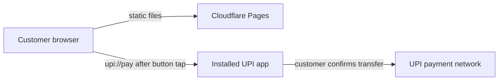

# Architecture

EZQRPRINT is a static React and Vite page served by Cloudflare Pages.

The build receives `VITE_UPI_ID` and `VITE_UPI_PAYEE_NAME`. It embeds those public payee details into a `upi://pay` link. The button is a user initiated link; the site does not automatically launch an app or attempt a payment.

There is no runtime database, Firebase project, payment gateway, server, customer account, file upload, or payment status callback in the deployed application. Cloudflare Pages hosts static assets only.

## Payment flow

1. A customer visits the shop's Pages URL.
2. The page shows the payee and UPI ID from the build configuration.
3. The customer taps **Pay via UPI**. The operating system opens a compatible installed UPI app when available.
4. The customer checks the payee, enters or confirms the amount, and decides whether to complete the transfer.
5. The shop independently checks its UPI app for the completed payment.
