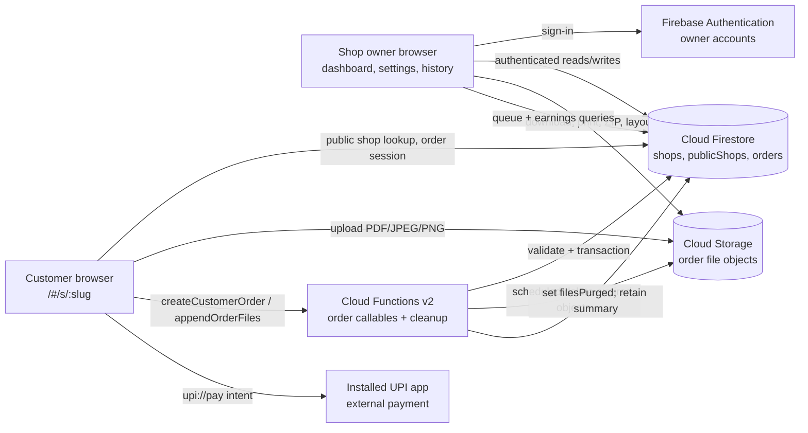

# EZQRPRINT Architecture

## System overview



The browser uses the Firebase Modular SDK and calls Firebase Functions for customer order writes. No customer account is required. The UPI app is external to Firebase; EZQRPRINT does not receive a payment-provider callback. Cloudflare Pages can serve the frontend as a static site; Firebase remains the backend.

## Routes

| Route | Access | Purpose |
| --- | --- | --- |
| `/` | Public | EZQRPRINT landing page |
| `/login`, `/register` | Public | Shop-owner authentication |
| `/#/s/:slug` | Public | Shop lookup, upload, order tracking, payment handoff, receipt |
| `/dashboard` | Owner | Live active-order queue and print actions |
| `/settings` | Owner | Shop name, permanent slug, rates, and merchant UPI settings |
| `/history` | Owner | Completed orders filtered by IST order date |

## Firestore data model

### `shops/{shopId}`

The shop document ID is the owner's Firebase Auth UID.

```text
id: string
ownerUid: string
shopName: string
slug: string
upiId?: string
upiPayeeName?: string
rates: { bwPerPage: number, colorPerPage: number }
dailyCounter: integer
lastOrderDate: "YYYY-MM-DD" (Asia/Kolkata)
createdAt: Timestamp
```

`dailyCounter` stores the most recently issued token number. A new IST date starts again at 101.

### `publicShops/{slug}`

Public projection used for the counter URL lookup:

```text
id: string
shopName: string
slug: string
upiId?: string
upiPayeeName?: string
rates: { bwPerPage: number, colorPerPage: number }
```

It omits owner UID and private shop counters.

### `orders/{orderId}`

`orderId` is generated on the client and is independent of the public token.

```text
id: string
shopId: string
tokenNumber: integer
status: "pending" | "printing" | "awaiting_payment" | "completed"
paymentClaimed: boolean
filesPurged: boolean
totalAmount: number
finalAmount: number
createdAt: Timestamp
expiresAt: Timestamp
files: OrderFile[]
```

Each `OrderFile` contains `fileName`, `storagePath`, `downloadUrl`, `mimeType`, `pageCount`, `copies`, `colorMode` (`bw` or `color`), `printSides` (`single` or `double`), `printNote` (`standard` or `id-card`), and `itemCost`. The callable writes an empty `downloadUrl`; the browser resolves a fresh URL from `storagePath` when downloading or printing. Double-sided files are billed at the existing B&W/Color rate for each printed page; staff enable duplex in their printer settings. No customer name, email, or phone fields are part of the order model.

### Storage objects

```text
shops/{shopId}/orders/{orderId}/{randomObjectId}
```

The random suffix has no customer-provided path components. The Firebase Storage object metadata contains the MIME type and size; the Firestore order contains its Storage path.

## Daily token transaction

1. The browser uploads selected files and calculates each file's page count, copies, mode, and estimated price.
2. It calls `createCustomerOrder` with the shop ID, random order ID, and file metadata.
3. The callable confirms that the shop and its public projection match; it validates file paths, types, limits, page/copy values, and prices against current shop rates.
4. In a Firestore Admin transaction, it reads the shop counter and new order ID. It computes the current `YYYY-MM-DD` in `Asia/Kolkata`; if it matches `lastOrderDate`, the token is `dailyCounter + 1`, otherwise it starts at `101`.
5. The same transaction updates `dailyCounter` and `lastOrderDate`, then creates the order with the token, totals, files, a timestamp, and `expiresAt = now + 24 hours`. The callable returns the token to the browser.

Firestore transactions serialize competing updates to a shop counter, preventing concurrent customers from receiving the same daily token. `appendOrderFiles` similarly validates new metadata and atomically updates the existing order while it is pending or printing, with a 20-file maximum. The UI displays the integer with a `#` prefix (for example `#101`).

## Upload, queue, and earnings flow

- The customer selects PDF/JPEG/PNG files, each no larger than 25 MB, and configures pages, copies, B&W/Color, and image print note.
- The browser uploads to the order's Storage prefix with resumable progress reporting.
- Firestore rules deny direct client creation of orders. Callable functions validate order inputs and rates; rules restrict owner access/updates and allow only the payment-claim customer update.
- The owner dashboard listens for `pending`, `printing`, and `awaiting_payment` orders, ordered by `createdAt`.
- The history page queries completed orders for one shop and one IST calendar day. Its date range uses the order's existing `createdAt` timestamp; the row label therefore says “Order time (IST).” Page totals multiply each file's page count by its copies.
- The hourly cleanup function removes expired Storage objects and sets `filesPurged: true` transactionally. It does not delete the order document, so summaries remain in history.

## PDF bulk merge and A4 layout pipeline

### Bulk print

1. The owner chooses **Bulk Print Order**.
2. The browser resolves a current Storage download URL from each `storagePath` (the bucket CORS policy permits the required GET/HEAD requests).
3. `pdf-lib` loads PDF files and copies every page for each requested copy. JPEG/PNG files are embedded on centered A4 pages, once per copy.
4. The browser creates one PDF Blob and opens the browser print dialog through a temporary iframe.

Encrypted or damaged PDFs return an explicit error. The original files remain available for manual downloads and external printing.

### A4 image studio

The studio fetches image files and uses an HTML canvas for preview, crop/rotation, drag-to-position, and optional contrast/brightness/grayscale cleanup. Grid presets use millimetres and convert to PDF points using `72 / 25.4`. N-up placements spill onto further A4 pages; the passport preset creates six 35 × 45 mm copies of the selected image on one sheet. The ID-card preset places selected front/back images at 85.6 × 54 mm with a 10 mm gap. `pdf-lib` writes the arranged pages; PNG export uses the selected canvas preview page.

## UPI intent flow

When an owner sets an order to `awaiting_payment`, the customer portal displays the final INR amount. If the shop has a merchant UPI ID, it creates a URI of the form:

```text
upi://pay?pa=<merchant-upi-id>&pn=<payee>&am=<amount>&cu=INR&tn=EZQRPRINT%20<token>
```

The link launches a compatible UPI app; a QR encoding the same URI is shown as a fallback. The customer may tap **I Have Paid**, which only sets `paymentClaimed: true`. Staff must independently confirm the payment and complete the order.
