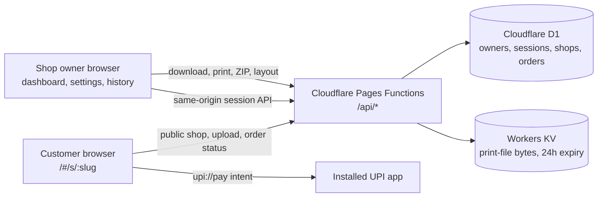

# EZQRPRINT Architecture

## System overview

The app is a same-origin Pages site and API. Customers have no account; the random order ID acts as a bearer identifier for status and payment-claim actions. Owners use email/password accounts and an HttpOnly, Secure, SameSite cookie. No Firebase project, R2 bucket, or payment processor is used.

## Routes

| Route | Access | Purpose |
| --- | --- | --- |
| `/` | Public | EZQRPRINT landing page |
| `/login`, `/register` | Public | Shop-owner authentication |
| `/#/s/:slug` | Public | Shop lookup, upload, order tracking, UPI handoff, receipt |
| `/dashboard` | Owner | Active-order queue and print actions |
| `/settings` | Owner | Shop name, permanent slug, rates, merchant UPI details |
| `/history` | Owner | Completed orders filtered by IST order date |
| `/api/*` | Pages Functions | Same-origin backend API |

## D1 data model

- `owners`: normalized email and PBKDF2 password hash plus random salt.
- `sessions`: SHA-256 hashes of random cookie tokens and expiry time.
- `shops`: one shop per owner, public slug, INR rates, optional UPI payee, and daily token counter.
- `orders`: status, token, totals, timestamps, file metadata, and purge state.

`migrations/0001_initial.sql` creates the tables and indexes. Dates are stored as epoch milliseconds; daily token resets use the `Asia/Kolkata` calendar day.

## Order flow

1. An owner registers, signs in, then saves a shop name, slug, print rates, and optional UPI ID/payee name.
2. A customer selects a shop URL and uploads files through `/api/uploads`. The server checks file size, type, and file signature before putting bytes in KV.
3. The customer sends file options to the order API. The server rechecks file paths, page/copy values, shop rates, and order size, allocates the next daily token in D1, and stores the order summary.
4. The owner queue refreshes every five seconds. The owner can download or print files, mark the job printing, request payment, confirm payment, or delete files early.
5. The customer status page refreshes every five seconds. When payment is requested and the shop has UPI details, the page creates a UPI app link and QR code. EZQRPRINT receives no payment callback.
6. KV expires file objects after 24 hours. D1 order summaries remain available for earnings history.

File objects use the key format `files/{shopId}/{orderId}/{randomUUID}`. A maximum of 20 files can belong to an order. Current upload validation accepts PDF, JPEG, and PNG up to 25 MiB each.

## Print tools

The owner browser downloads files through an owner-authenticated API route. `pdf-lib` builds combined PDFs and A4 layouts; JSZip packages original files. The browser opens the native print dialog. The ID-card crop and image layout tools run in the browser.

## UPI

The customer page builds a `upi://pay` URL with payee, amount, INR, and token. The URL opens a compatible app or is encoded in a QR. The customer may report payment, but the shop owner must verify settlement independently before completing the order.
